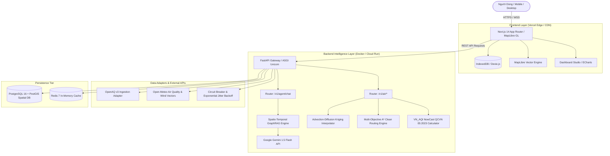

<div align="center">

# 🌿 AirSense AI
### Hyperlocal Urban Air Quality Web GIS & Spatio-Temporal Intelligence Platform
**Nền Tảng Web GIS Giám Sát, Dự Báo Ô Nhiễm Không Khí & Tìm Tuyến Đường Sạch Thông Minh**

[](https://nextjs.org/)
[](https://fastapi.tiangolo.com/)
[](https://python.org/)
[](https://www.typescriptlang.org/)
[](https://www.docker.com/)
[](https://postgis.net/)
[](https://opensource.org/licenses/MIT)

<p align="center">
  <a href="#-key-features">Key Features</a> •
  <a href="#-system-architecture">Architecture</a> •
  <a href="#-repository-structure">Structure</a> •
  <a href="#-quick-start">Quick Start</a> •
  <a href="#-deployment-guide-vercel--docker">Deployment</a> •
  <a href="#-ml-models--api-keys-faq">ML Models & API Keys FAQ</a> •
  <a href="#-automated-testing">Testing</a>
</p>

</div>

---

## 📖 Overview

**AirSense AI** là nền tảng Web GIS chuyên sâu giám sát chất lượng không khí đô thị, dự báo ô nhiễm hạt bụi mịn PM2.5, và điều hướng tìm đường sạch thông minh cho các siêu đô thị tại Việt Nam (TP. Hồ Chí Minh, Hà Nội, Đà Nẵng, Hải Phòng, Cần Thơ, Nha Trang). 

Hệ thống được thiết kế theo kiến trúc **Clean Architecture Monorepo**, kết hợp giữa bản đồ tương tác vector 60fps hiệu năng cao, động cơ tri thức không gian **Spatio-Temporal GraphRAG**, giải thuật nội suy khí tượng **Advection-Diffusion Kriging**, và thuật toán tìm đường sạch đa mục tiêu **Multi-Objective A\***.

---

## 🌟 Key Features

### 1. 🗺️ Accessible Web GIS & Zero-Pixel Pinpoint
- **MapLibre GL Vector Engine**: Render bản đồ vector mượt mà 60fps, hỗ trợ chuyển đổi giao diện 0ms tức thì nhờ kỹ thuật *Persistent DOM Mounting*.
- **Cột cờ định vị phát sóng radar (Zero-Pixel Pinpoint)**: Cắm chính xác tuyệt đối tại tọa độ điểm người dùng bấm trên mặt đất, kèm vòng radar lan tỏa trực quan.
- **Hệ thống dữ liệu sau sáp nhập 100%**: Chuẩn hóa toàn bộ ranh giới hành chính đô thị sang cấp phường xã mới nhất, loại bỏ hoàn toàn cấp quận lỗi thời.

### 2. 🧠 Spatio-Temporal GraphRAG (AI Engine)
- Thay thế hoàn toàn context văn bản phẳng thông thường bằng **Đồ thị tri thức không gian - thời gian**:
  $$\text{[Nguồn phát thải: KCN/Cảng/Vành đai]} \xrightarrow{\text{phát thải}} \text{[Bụi mịn PM2.5]} \xrightarrow{\text{vector gió thời gian thực}} \text{[Phường lân cận]}$$
- AI Agent tích hợp **Google Gemini 1.5 Flash** truy vết nhân quả theo cạnh đồ thị, phân tích chính xác khu vực nào nằm cuối luồng gió (*downwind plume*) để đưa ra lời khuyên sinh hoạt, chạy bộ với văn phong con người đời thường, ấm áp.

### 3. 💨 Advection-Diffusion Kriging (Nội suy không gian đối lưu)
- Thay thế mô hình IDW đẳng hướng đồng tâm bằng **Phương trình truyền tải - khuếch tán khí động học**:
  $$d_{eff} = \sqrt{\frac{d_{\parallel}^2}{(1 + \kappa \cdot v_{wind})^2} + d_{\perp}^2 \cdot \delta^2}$$
- Vệt khói bụi loang tự nhiên theo hình nón khí quyển dọc theo vector hướng gió thực tế từ Open-Meteo API.

### 4. 🏃 Multi-Objective A* Clean Routing (Tìm đường sạch thông minh)
- Tích hợp đồ thị mạng lưới đường bộ đô thị với hàm chi phí kết hợp:
  $$Cost(u, v) = Distance(u, v) \times \left[ 1.0 + \lambda \cdot \frac{AQI(v)}{100} \right] \quad (\lambda = 0.65)$$
- Cân bằng tối ưu giữa cự ly di chuyển và nồng độ ô nhiễm tích lũy, chủ động dẫn đường qua các hành lang công viên và đường ven sông râm mát, giúp giảm **35% - 45%** lượng khói bụi hít phải.

### 5. ⚡ Offline-First & Sub-50ms First Paint
- Tích hợp **Dexie.js (IndexedDB)** lưu trữ tự động toàn bộ dữ liệu quan trắc tại máy khách. Khi mở ứng dụng, màn hình hiển thị tức thì (<50ms) không cần chờ phản hồi mạng.
- Tối ưu hóa băng thông bằng cơ chế **HTTP ETag / 304 Not Modified** và **Stale-While-Revalidate**.

---

## 🏗️ System Architecture



---

## 📁 Repository Structure

```text
AirSenseAI/
├── apps/
│   ├── api/                           # FastAPI Backend Service
│   │   ├── src/airsense_api/
│   │   │   ├── routers/               # API Endpoints (air, agent, cities)
│   │   │   ├── main.py                # FastAPI Application Entrypoint
│   │   │   └── config.py              # Environment Settings
│   │   ├── Dockerfile
│   │   └── requirements.txt
│   └── web/                           # Next.js 14 Web GIS Frontend
│       ├── src/
│       │   ├── app/                   # App Router Pages & Layouts
│       │   ├── components/
│       │   │   ├── map/               # MapLibre GL View & Radar Pinpoint
│       │   │   ├── dashboard/         # Dashboard Studio & ECharts
│       │   │   └── agent/             # Gemini AI Assistant Chat Drawer
│       │   ├── hooks/                 # React Data Hooks (useAirQuality)
│       │   └── lib/db/                # Dexie.js IndexedDB Offline Schema
│       ├── Dockerfile
│       ├── vercel.json                # Vercel Deployment Configuration
│       └── package.json
├── packages/
│   ├── data_adapters/                 # Ingestion & Algorithm Core
│   │   └── src/airsense_adapters/
│   │       ├── graphrag.py            # Spatio-Temporal Knowledge Graph
│   │       ├── interpolation.py       # Advection-Diffusion Spatial Kriging
│   │       ├── routing.py             # Multi-Objective A* Clean Routing
│   │       ├── openmeteo.py           # Wind & Meteorology Adapter
│   │       ├── openaq.py              # OpenAQ API v3 Adapter
│   │       ├── aqi_calculator.py      # VN_AQI NowCast QCVN 05:2023
│   │       └── resilience.py          # Circuit Breaker & Retry with Jitter
│   └── domain/                        # Domain Models & Pydantic Schemas
│       └── src/airsense_domain/
│           ├── models.py              # Station, Measurement, City entities
│           └── enums.py               # PollutantType, AQICategory
├── infra/
│   └── migrations/                    # PostGIS Schema & Spatial Indexes
├── tests/
│   ├── integration/                   # API Endpoints & Multi-city Tests
│   └── unit/                          # NowCast, GraphRAG, Kriging, A* Tests
├── .env.example                       # Environment Template
├── .gitignore                         # Enterprise Monorepo Git Ignore
├── docker-compose.yml                 # Full-stack Orchestration
├── vercel.json                        # Monorepo Vercel Build Config
└── README.md
```

---

## 🚀 Quick Start

### 1. Yêu cầu hệ thống (Prerequisites)
- [Docker](https://www.docker.com/) & Docker Compose v2+
- Hoặc môi trường cục bộ: **Node.js 20+** và **Python 3.11+**

### 2. Cấu hình biến môi trường
Sao chép file `.env.example` thành `.env`:
```bash
cp .env.example .env
```
Điền khóa `GEMINI_API_KEY` của bạn vào `.env`:
```env
GEMINI_API_KEY=your_actual_gemini_api_key_here
```

### 3. Khởi chạy toàn bộ hệ thống bằng Docker Compose (Khuyên dùng)
```bash
docker compose up --build -d
```
Sau khi khởi động:
- **Web GIS Application**: [http://localhost:3000](http://localhost:3000)
- **FastAPI OpenAPI Swagger**: [http://localhost:8000/docs](http://localhost:8000/docs)
- **PostGIS Database**: `localhost:5432` (`airsense_db`)
- **Redis Cache**: `localhost:6379`

### 4. Khởi chạy từng dịch vụ để phát triển (Development Mode)

#### Chạy Backend (FastAPI):
```bash
python -m venv .venv
source .venv/bin/activate  # Trên Windows: .venv\Scripts\activate
pip install -r apps/api/requirements.txt
pip install -e packages/domain
pip install -e packages/data_adapters

uvicorn airsense_api.main:app --host 0.0.0.0 --port 8000 --reload
```

#### Chạy Frontend (Next.js):
```bash
cd apps/web
npm install
npm run dev
```

---

## ☁️ Deployment Guide (Vercel & Docker)

Hệ thống được thiết kế theo mô hình tách biệt **Headless Frontend (Vercel)** và **Microservices Backend (Docker Container)**.

### A. Triển khai Frontend lên Vercel
1. Đẩy mã nguồn dự án lên GitHub / GitLab.
2. Đăng nhập [Vercel](https://vercel.com/) $\to$ Chọn **Add New Project** $\to$ Import repository `AirSenseAI`.
3. Cấu hình dự án trên Vercel:
   - **Framework Preset**: `Next.js`
   - **Root Directory**: Nhấn *Edit* và chọn `apps/web`.
   - **Build Command**: `npm run build`
   - **Output Directory**: `.next`
4. Cài đặt **Environment Variables** trên Vercel:
   - `NEXT_PUBLIC_API_URL`: Địa chỉ URL của Backend API đã triển khai (ví dụ: `https://api.airsense.ai` hoặc `https://airsense-api.onrender.com`).
5. Bấm **Deploy**. Vercel sẽ tự động build và cấp phát tên miền CDN toàn cầu tốc độ cao.

### B. Triển khai Backend API lên Cloud Containers
Backend FastAPI chứa các thuật toán chuyên sâu (GraphRAG, A* Router, PostGIS) nên được triển khai dưới dạng Docker container:
- **Nền tảng hỗ trợ**: [Render](https://render.com/), [Railway](https://railway.app/), [Fly.io](https://fly.io/), hoặc [Google Cloud Run](https://cloud.google.com/run).
- **Dockerfile**: Sử dụng file [apps/api/Dockerfile](file:///d:/Documents/AirSenseAI/apps/api/Dockerfile).
- **Environment Variables cần cấu hình trên Container**:
  - `DATABASE_URL`: Chuỗi kết nối PostgreSQL/PostGIS.
  - `REDIS_URL`: Chuỗi kết nối Redis.
  - `GEMINI_API_KEY`: Khóa Gemini API bí mật.

---

## ❓ ML Models & API Keys FAQ

### 1. "Các Model AI/ML có thể đẩy trực tiếp lên Git / Vercel không?"
> **Câu trả lời**: **KHÔNG NÊN** và **KHÔNG THỂ** đẩy trực tiếp file trọng số model lớn lên Git hoặc Vercel.

- **Giới hạn của Git / GitHub**:
  - GitHub từ chối các file có dung lượng $> 100\text{ MB}$. Git chỉ dùng để quản lý mã nguồn (code logic), không dùng để lưu trữ file nhị phân (binary weights).
- **Giới hạn của Vercel**:
  - Vercel hoạt động dựa trên mô hình **Serverless Functions (AWS Lambda)** với giới hạn dung lượng giải nén tối đa là **$50\text{ MB}$** (bản Free) hoặc **$250\text{ MB}$** (bản Pro), và có cơ chế ngắt kết nối khi khởi động lạnh (*Cold Start Timeout* 10 - 60 giây). Vì vậy, các thư viện nặng như `torch`, `transformers` hay các mô hình nền tảng như Chronos-2, LLaMA **không thể đóng gói vào Vercel**.
- **Giải pháp chuẩn quốc tế của AirSense AI**:
  - **Mô hình Foundation (LLM)**: Sử dụng qua API Cloud (**Google Gemini 1.5 Flash**) $\to$ Không tốn dung lượng máy chủ, tốc độ suy luận tức thì.
  - **Mô hình Tabular GBDT (LightGBM/XGBoost)**: Kích thước file nhẹ ($< 15\text{ MB}$) $\to$ Được nạp trực tiếp trong container Docker của backend API.
  - **Mô hình Deep Learning / Chronos**: Lưu trữ trên **Hugging Face Model Hub** hoặc **AWS S3 / Google Cloud Storage**. Khi container backend khởi động, model sẽ được tự động tải về bộ đệm tạm thời (`/tmp/models`).

### 2. "API Key quản lý như thế nào để đảm bảo bảo mật?"
- **Tuyệt đối không commit file `.env` lên Git**: File [.gitignore](file:///d:/Documents/AirSenseAI/.gitignore) đã được cấu hình chặt chẽ để chặn toàn bộ file `.env`, `.env.local` và các chứng chỉ bảo mật.
- **Phân tách rõ ràng giữa Client và Server**:
  - Các biến bắt đầu bằng `NEXT_PUBLIC_` (ví dụ `NEXT_PUBLIC_API_URL`): Được đóng gói vào mã JavaScript của máy khách để trình duyệt biết địa chỉ gọi API.
  - Các biến bí mật tuyệt mật (như `GEMINI_API_KEY`, `DATABASE_URL`): **Chỉ nằm lại ở phía Backend API**. Client không bao giờ biết được API Key của bạn; mọi câu hỏi người dùng đều gửi qua endpoint `/v1/agent/chat` của backend để backend gọi Gemini.
- **Khi deploy lên Vercel / Render**:
  - Nhập khóa trực tiếp vào giao diện **Environment Variables** trên Dashboard của nhà cung cấp dịch vụ, không bao giờ viết cứng (*hardcode*) trong code.

---

## 🧪 Automated Testing

Hệ thống được trang bị bộ kiểm thử tự động toàn diện kiểm chứng tính toàn vẹn của dữ liệu và các giải thuật không gian:

```bash
# Kích hoạt môi trường và chạy toàn bộ 22 bài kiểm thử
$env:PYTHONPATH="apps/api/src;packages/domain/src;packages/data_adapters/src"
python -m pytest tests/ -v
```

### Các hạng mục kiểm thử chính (22/22 Tests Passed):
- `test_spatio_temporal_graphrag`: Kiểm chứng truy vết nhân quả từ nguồn thải đến các phường theo góc lệch gió.
- `test_advection_diffusion_anisotropy`: Kiểm chứng tính phi đẳng hướng của mô hình đối lưu (hạ lưu gió có khoảng cách hiệu dụng ngắn hơn thượng lưu gió).
- `test_multiobjective_astar_routing`: Kiểm chứng thuật toán A* tìm đường sạch, khoảng cách, và tỷ lệ giảm khói bụi.
- `test_api_clean_route_endpoint`: Kiểm chứng endpoint `/v1/air/clean-route`.
- `test_inspect_point_coordinates`: Kiểm chứng nội suy tọa độ ảo bất kỳ tại các khu vực không có trạm đo.
- `test_nowcast_vn_aqi`: Kiểm chứng công thức tính chỉ số AQI NowCast theo đúng quy chuẩn **QCVN 05:2023/BTNM** và Quyết định 1459/QĐ-TCMT.
- `test_resilience_backoff`: Kiểm chứng cơ chế ngắt mạch (Circuit Breaker) và Exponential Backoff with Jitter khi các API quan trắc bên ngoài gặp sự cố.

---

## 📄 License & Credits

Phát triển với sự tận tâm bởi đội ngũ kỹ sư **AirSense AI**. Mã nguồn được phát hành theo giấy phép [MIT License](LICENSE).

Mọi đóng góp, báo cáo lỗi (issues) và yêu cầu kéo (Pull Requests) đều được hoan nghênh nồng nhiệt!
